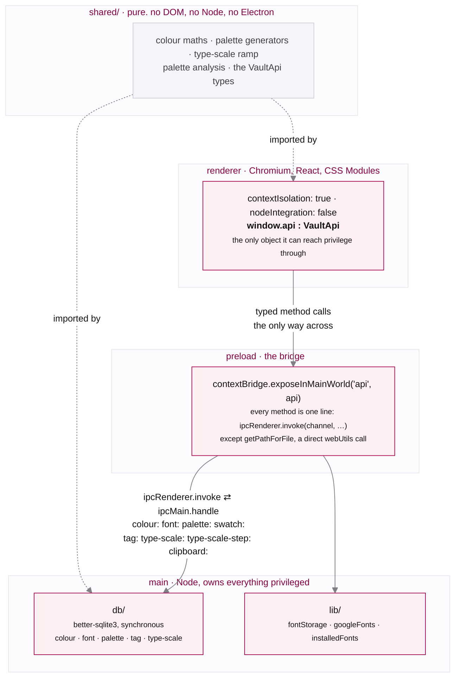
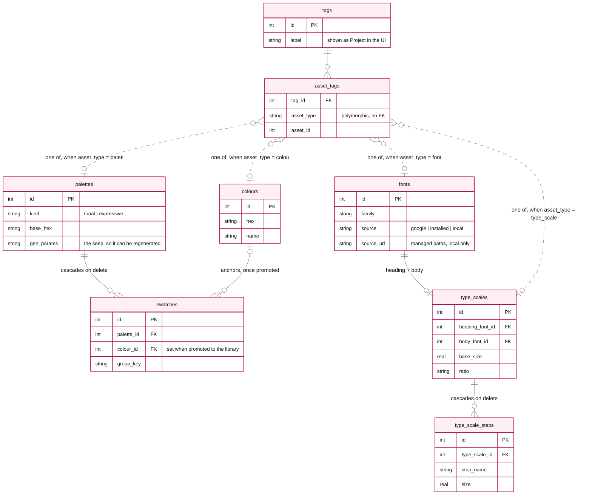
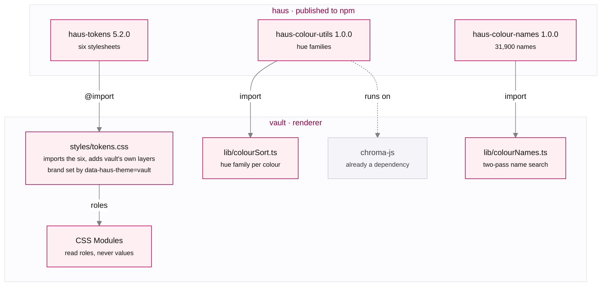

# Vault: architecture

How Vault is built: its processes and the boundary between them, the data model, the mechanisms
behind colour naming, palettes, type scales, fonts and the command palette, and how it is tested.
The visual design and the design system are in [`DESIGN.md`](./DESIGN.md).

## Contents

- [Overview](#overview)
- [Data model](#data-model)
- [Boundaries and security](#boundaries-and-security)
- [Colour naming](#colour-naming)
- [Palette generators](#palette-generators)
- [Type scales](#type-scales)
- [Font storage](#font-storage)
- [Command palette ranking](#command-palette-ranking)
- [Testing and CI](#testing-and-ci)
- [Platform and stack](#platform-and-stack)
- [Known trade-offs](#known-trade-offs)

---

## Overview

Vault is an Electron app. Main owns everything privileged, the preload is a one-line-per-method
bridge, the renderer is a sandboxed React app, and `shared/` holds pure code that both sides
import.

### What the renderer cannot do

`nodeIntegration: false` means renderer code has no `require`, and `contextIsolation: true` runs
the preload script in a separate JavaScript world from the page. The renderer cannot read the
preload's scope, reach into `ipcRenderer` directly, or monkey-patch its way to Node. It sees
`window.api` and nothing else. Every database write and file read in Vault happens on the far side
of that boundary. Network traffic is the one exception, described under
[Outbound traffic](#outbound-traffic).

### Shared code

The palette generators run in both processes. The renderer runs them to preview a palette live,
and main re-runs them from the same seed before writing to SQLite. The saved palette and the
previewed one cannot drift, because they are the same function over the same input.

Type scales take the other route. The renderer materialises the steps and main only persists the
rows, so `shared/` there is shared across the renderer's own create flow, viewer and card rather
than across the process boundary. It holds the ratio presets and the rule for what counts as a
hand-tuned scale.

### Renderer code

State and IPC calls live in `hooks/`, pure helpers in `lib/`. Components sit in three tiers,
atoms, molecules and organisms, described in [`DESIGN.md` § Components](./DESIGN.md#components).

---

## Data model

SQLite, one file. Two library tables (`colours`, `fonts`), two generated artefacts each with their
own children (`palettes` + `swatches`, `type_scales` + `type_scale_steps`), and a generic `tags` /
`asset_tags` join so any asset can belong to projects.

Library items (colour, font) belong to **many** projects. Generated artefacts (palette, type
scale) are meant to belong to **one**: creation assigns at most one, the interface offers no way to
add another, and the type scale view shows only the first it finds. That rule is the interface's,
not the database's. `tag:assign` and `tag:remove` accept any asset type, so nothing below the
interface stops an artefact gaining a second project or losing its only one.

`asset_tags` is polymorphic, so SQLite cannot enforce it with a foreign key and cannot cascade it.
The dashed relationships above are held by convention, and cleaning them up on delete is the
application's job.

Why the interface calls tags "Projects" is in
[`DESIGN.md` § Projects](./DESIGN.md#projects).

---

## Boundaries and security

### Sandbox and CSP

The renderer runs with `sandbox: true` (`src/main/index.ts`). The built preload requires one
module, `electron`, which a sandboxed preload can load, and it holds no Node API of its own. The
preload is the only code that can reach `ipcRenderer`, so it holds no logic: every method on it is
a one-line forwarding call to main, except `getPathForFile`, which calls Electron's `webUtils` in
the preload itself (see [File paths from drag and drop](#file-paths-from-drag-and-drop)).

The built `index.html` carries a Content-Security-Policy as a meta element, injected at build time
in `electron.vite.config.ts`. It is build-only because the dev server needs inline scripts, `eval`
and a websocket for HMR, and a `file://` response has no headers to carry a policy. It allows what
the app uses and nothing else: Google Fonts for the stylesheet and its faces, inline styles for the
previews React sizes at runtime, and `data:` and `blob:` images for the exports.

Both arrived on 2026-09-01 in `vault#26`. `sandbox` had been off as the project template's
default, and nothing needed the exemption.

### Outbound traffic

Vault makes three outbound requests, all to Google Fonts, and each one starts from something the
user does with fonts.

| Request                                                               | Starts when                                                                                                           | Where from   | Host                                             |
| --------------------------------------------------------------------- | --------------------------------------------------------------------------------------------------------------------- | ------------ | ------------------------------------------------ |
| The family metadata catalogue (`getGoogleFonts`)                      | The font adder first opens in a session                                                                               | main         | `fonts.google.com`                               |
| A family's CSS, then its `.woff2` bytes (`font:download-google`)      | "Download font file" is pressed on a Google font                                                                      | main         | `fonts.googleapis.com`, then `fonts.gstatic.com` |
| The stylesheet that renders a Google font in a preview (`fontLoader`) | The Fonts or Type scales page opens, once per Google font in the library, and a family is previewed in the font adder | **renderer** | `fonts.googleapis.com`, then `fonts.gstatic.com` |

The third is the exception to the boundary. Previewing a Google-sourced font appends a
`<link rel="stylesheet">` to the document, so that request leaves the renderer rather than main.
Everything else stays local: the database, the library, every colour, palette and type scale.
There is no telemetry, no account check and no update ping.

### File paths from drag and drop

`getPathForFile` is a direct `webUtils` call in the preload rather than an `invoke`, the one
method that is not IPC. Electron's file objects no longer expose a filesystem path to the
renderer, so this resolves a dropped `File` to its real path on the privileged side and hands back
a string. It is exposed on `window.api` like every other method, so any renderer code can call it,
not only the drop handler. What limits it is the argument: it takes a `File` object, not a path,
and returns an empty string for a `File` that has no file on disk behind it (one built in script
with `new File()`). Renderer code can learn the path of a file the user dropped or picked, and
cannot use the method to name one.

### Window lockdown

`will-navigate` refuses any top-level navigation that is not the bundled app (or the dev server in
development), so nothing that can set `location.href` can move the window, and the `window.api`
surface with it, to a remote origin. `setWindowOpenHandler` denies every new window and hands
`http(s)` links to the system browser.

---

## Colour naming

Every captured colour is named automatically, and every ramp is built, in a perceptual space (LCH,
with ΔE2000 as the distance), so steps look even and a match reads as a person would judge it. RGB
distance puts colours close together that do not look alike.

The name search makes two passes over the 31,900 names. A CIE76 scan, a cheap Euclidean distance in
Lab, cuts the field to the candidates inside a radius, then CIEDE2000 re-scores only those.
CIEDE2000 is the accurate measure and the expensive one, which is why it only sees the shortlist.
Ranking uses the raw distance; the value is rounded for display only.

### Name dataset

**Decision.** The 31,900 names come from `haus-colour-names`.

**Reason.** The dataset is maintained and versioned in one published package, so vault does not
carry a copy of its own.

**Alternatives.** A 764 KB `colornames.json` committed to this repo.

### Hue families

**Decision.** The hue family bins come from `haus-colour-utils`. Its 0.3.0 release fits the
boundaries to 4,275 human-named colours.

**Reason.** The bins are a shared decision, so they live in one place and vault reads them. Fitting
replaced midpoints between eight anchor colours, which assumed a family is centred on the colour it
is named after. With the fitted bins, fourteen swatches in a real library change family, all of
them toward what the eye reads. Vault took the change without code of its own.

**Alternatives.** Vault's own copy, with the same shape and the boundaries of an HSL wheel. That
is a different wheel: sRGB red sits at OKLCH hue 29 rather than 0, so every family sat about one
bin anticlockwise of where it belonged and 17 of 27 canonical colours were misnamed.

### Search implementation

**Decision.** The two-pass search is vault's own code.

**Reason.** Vault needs confidence bands, which count every candidate inside the scan radius by
distance band, and de-duplication by name, which makes the runner-up list read as alternatives.

**Alternatives.** `createNamedColourMatcher` in `haus-colour-utils` runs the same two passes but
returns a ranked top-N. Delegating would mean asking for the whole pool and re-deriving both here.

---

## Palette generators

A palette is one of two models, built by the same two-pane create flow with a different generator.

- **Tonal** builds a primary from one seed, a near-grey neutral at the same lightness, and success,
  warning and error hues rotated to fixed angles but kept in the seed's chroma family.
- **Expressive** takes several seeds and fills out the set one of three ways. _Cohesive_, the
  default, adds each new hue by maximising its perceptual distance from the hues already chosen.
  _Interpolate_ walks the gaps between the seeds. _Harmony_ places the extras at classical
  intervals from the first seed.

Either result is measured for hue coverage, and two swatches close enough to read as duplicates
are flagged. Changing the model or a seed recomputes the palette and the analysis together. The
seed is stored in `gen_params`, so a saved palette can be regenerated, and main regenerates it
before writing (see [Shared code](#shared-code)).

---

## Type scales

### Presets

**Decision.** Two presets, chosen at creation: _Product_ (Display down to Label) and _Web/Markup_
(h1 to h6, plus paragraph and small).

**Reason.** The chosen ramp is materialised into rows, so a second preset has no schema cost, and
the kind is recoverable from the step names.

### Units

**Decision.** Sizes are stored in px, line heights as unitless multipliers and tracking in em. The
viewer converts live (px, rem or pt; unitless, px or %; em, px or %) through one popover, and export
writes whatever is selected.

**Reason.** Units are a reading concern, so storage stays in one set and the reading changes. The
one exception is on export: `letter-spacing` takes no percentage in CSS, so a tracking reading of
`-2%` exports as `-0.02em`. The viewer keeps the percentage because that is how type is discussed.

---

## Font storage

**Decision.** Fonts come from three sources. **Installed** fonts (enumerated through
`system_profiler`, the Font Book set) and **file uploads** are copied into app storage on import.
**Google** fonts are stored as family, category and weights only; previews render from Google's
CDN over a stylesheet link, and `Download` fetches the `.woff2` on demand and saves it where the
user chooses.

**Reason.** Owning the bytes means a moved or deleted original never breaks the library, and the
file stays shareable through Show in Finder and Download.

Copying Google bytes on add is listed under [Known trade-offs](#known-trade-offs).

---

## Command palette ranking

The ⌘K palette ranks results with a pure function, `lib/commandFilter.ts`, which has its own unit
tests. It is a subsequence match, so `tsc` finds _Type Scales_. Each matched character scores a
point, a run of adjacent characters three more, and a match at a word start two more; skipped
characters cost a little, up to a cap. A short label gets a small edge over the same match in a
long one, so a three-letter query does not surface the longest thing it happens to fit.

Why the palette exists is in [`DESIGN.md` § Command palette](./DESIGN.md#command-palette).

---

## Testing and CI

- **Unit and component tests.** 308 Vitest tests across 35 files. The pure logic in `shared/` and
  `lib/` is covered directly: the exporters, the colour maths, both palette generators, gamut
  mapping, type-scale units and the command filter. The component suite runs in jsdom, and 20 of
  its 22 files carry axe assertions. Run the suite on Node 22: on Node 20 the jsdom files fail to
  start and only the logic suite runs.
- **End-to-end tests.** A Playwright suite (`e2e/`, `npm run e2e`) launches the built app, so main,
  preload, renderer and SQLite are all real. It checks that the app opens on an empty library, that
  a colour can be added, named and persisted through IPC, and that the renderer cannot reach Node.
  CI does not run it.
- **CI** runs on every push to `main` and every pull request: ESLint, Stylelint, the prose
  punctuation check, Prettier, typecheck, the Vitest suite and a production build.
- **Figma parity.** A second workflow compares vault's tokens and components with the Figma files
  on every pull request; 29 more Vitest tests cover its decision rules. What it compares and how it
  decides are in [`WORKFLOW.md` § Design sync](./WORKFLOW.md#design-sync).
- **Releases.** A tagged release builds unsigned `.dmg` installers for Apple Silicon and Intel and
  attaches them to a draft GitHub release, published by hand once its notes are edited.

---

## Platform and stack

### Electron

**Decision.** Electron.

**Reason.** Mature native APIs (Font Book access, dialogs, the dock) and one language across
processes.

**Alternatives.** Tauri, whose smaller binaries mattered less for a personal desktop tool.

### SQLite driver

**Decision.** `better-sqlite3`, with hand-written SQL.

**Reason.** It is synchronous, and the schema is small enough that hand-written SQL is clearer than
a query builder.

**Alternatives.** An ORM.

### Styling

CSS Modules. The reasoning is a design-system decision, in
[`DESIGN.md` § Styling](./DESIGN.md#styling).

### Runtime floor

Electron 45 and `better-sqlite3` 13 both require Node 22. Stylelint 18 and jsdom 31 raise the floor
to 22.22.2 (or 24.15, or 26), and `engines` records that range; `.nvmrc` asks for the latest 22. The
SQLite driver ships N-API prebuilds, so nothing rebuilds it at install time; electron-builder still
rebuilds at package time through its own copy.

### haus packages

Vault consumes three packages from the haus design system, all in the renderer, and no haus
components (the reason is in [`DESIGN.md` § Components from haus](./DESIGN.md#components-from-haus)).

`styles/tokens.css` imports six haus-tokens stylesheets, then appends vault's own two cascade
layers after haus's five, so vault's primitives win against the system they theme. The `vault`
brand applies through `data-haus-theme="vault"` on `<html>`: `brands/vault.css` supplies the
fifty-four brand entries and `semantics.css` resolves every role from them. How a component's
colour travels from role to primitive is in [`DESIGN.md` § Tokens](./DESIGN.md#tokens).

### Production dependencies

Sixteen packages reach the shipped app: React, React DOM and its scheduler, the SQLite driver and
its addon API, chroma-js, culori, react-colorful, the Font Awesome packages, the Manrope typeface,
and the three haus packages above. None of the three adds a transitive dependency.

### Distribution

A direct download from GitHub Releases, not the App Store. The build is unsigned, so the README
has the one-time quarantine step.

---

## Known trade-offs

- **Storage durability.** Data lives in the app's `userData` folder, so it survives a moved
  application and is not backed up anywhere. The planned next step is a nominated vault folder,
  Obsidian-style: assets and data in one portable, sync-able directory.
- **Google fonts are references.** Copying a Google font's bytes into the library on add would
  make the library fully offline. It is the next change to font storage.
- **Variable fonts.** Installed-font import reads one weight per face from `system_profiler`;
  variable axes are not expanded yet.
- **Unsigned build.** The `.dmg` is not signed or notarised, so first launch needs the quarantine
  step in the README.
