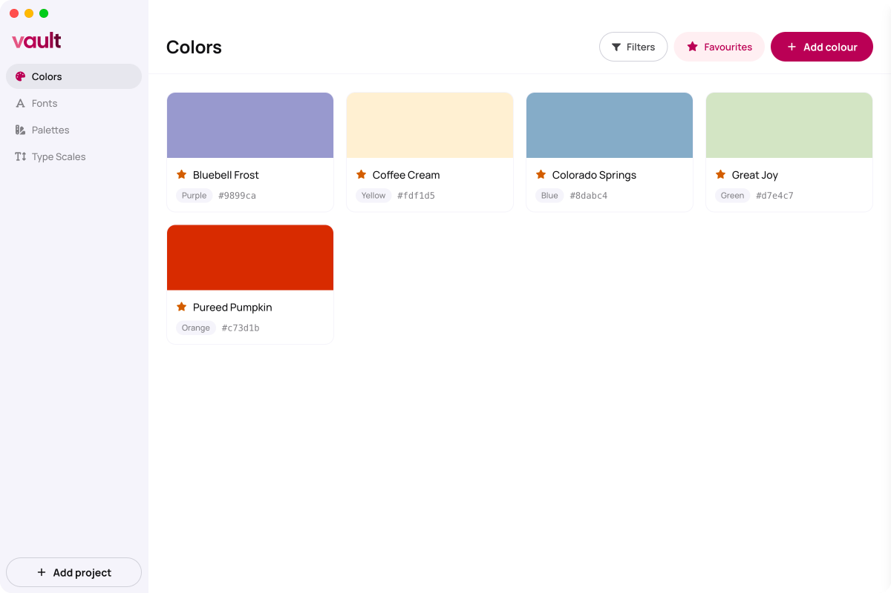
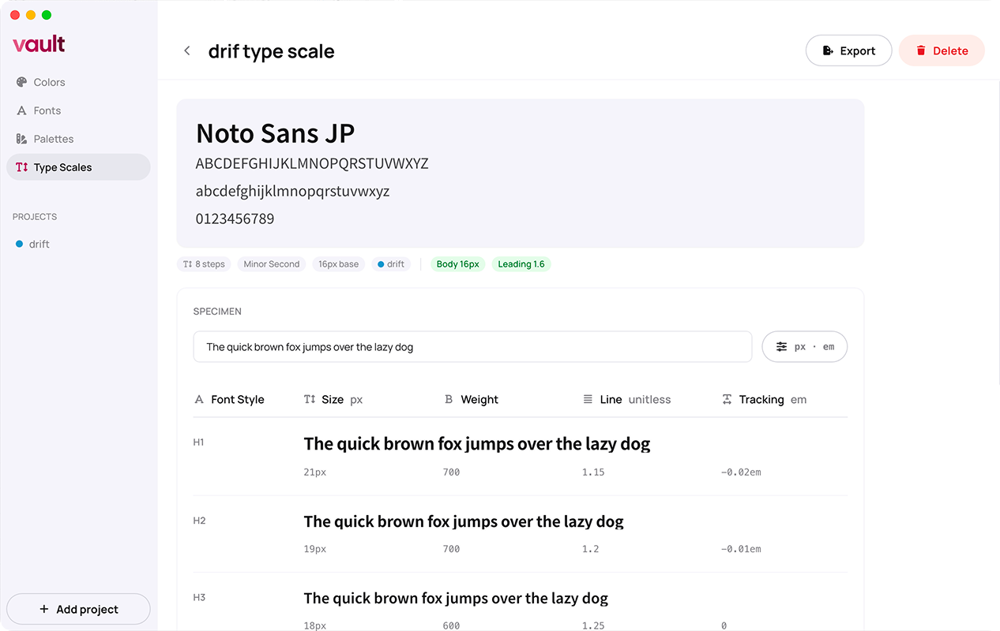
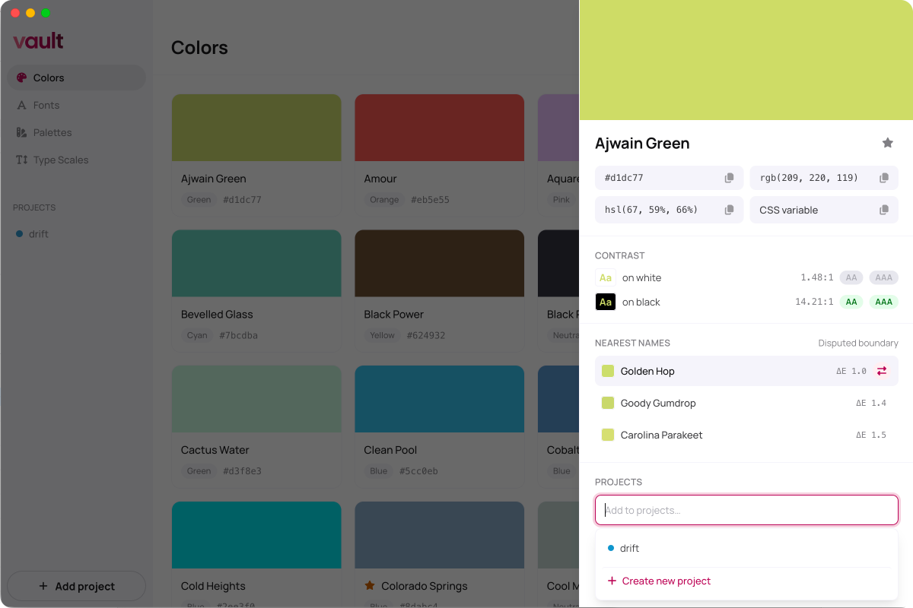
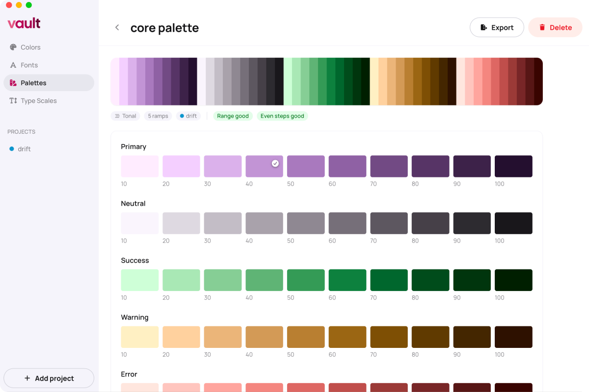
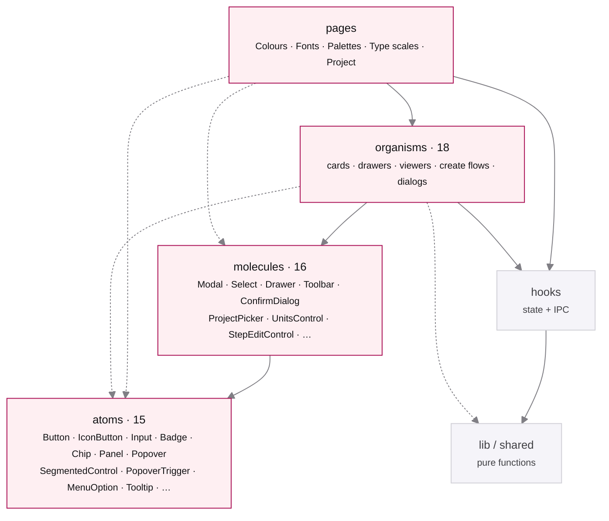

# Vault: design

How Vault looks and behaves, and the design system behind it. The Figma files (tokens, atoms,
molecules, organisms and screens) are on [figma.com/@hipuku](https://www.figma.com/@hipuku). How
the app is built is in [`ARCHITECTURE.md`](./ARCHITECTURE.md).

## Contents

- [Visual language](#visual-language)
- [Typography](#typography)
- [Layout and interaction](#layout-and-interaction)
- [Design system](#design-system): [Tokens](#tokens), [Components](#components),
  [Styling](#styling), [Accessibility](#accessibility), [Enforcement](#enforcement)
- [Known gaps](#known-gaps)

---

## Visual language

### Accent

**Decision.** Ruby, built as an OKLCH ramp anchored on `#AA1155` and `#880044`, is reserved for
actions: primary buttons, the active filter and nav item, focus rings, and the wordmark. Everything
else is the neutral `onyx` grey.

**Reason.** With the accent on actions only, the colours in the library are the most saturated
thing on screen. The token chain that holds this is under [Tokens](#tokens).



### Favourite state

**Decision.** The favourite star is gold, `--accent-gold` (`oklch(60% 0.175 65)`), a token of
vault's own.

**Reason.** A favourite is state, and state should not read as something to click, so it stays out
of the ruby. It is its own token rather than a read of the warning ramp it happens to match, so it
does not move when that ramp does.

### Shape

**Decision.** Buttons, nav items and tags are fully rounded (`--radius-full`).

**Reason.** A stylistic preference, applied to every control of those kinds so the shape is the
same across the app.

### Icons

**Decision.** Font Awesome's solid set, as SVG React components.

**Reason.** It sits at a more consistent optical weight next to Manrope, and the SVG packages
tree-shake to the icons used, so there is no icon font to flash in.

**Alternatives.** Lucide, the first choice, dropped for the weight mismatch.

### Theme

**Decision.** Light only.

**Reason.** One pale theme keeps the saved colours and type the brightest thing on screen, and
keeps the design work on one surface. Tokens have two tiers, primitives and semantic aliases, so a
dark theme is an override of the aliases. It has been deferred, not ruled out (see
[Known gaps](#known-gaps)).

---

## Typography

### Typeface

**Decision.** Manrope, variable from 200 to 800, bundled with the app as
`@fontsource-variable/manrope`. Specimen previews use a serif from vault's own tokens.

**Reason.** Vault works offline, so it cannot load a font from a CDN. Manrope is a
geometric-humanist sans with a real weight axis, and the type scale tool shows hierarchy through
weight, which needs the full axis.

**Alternatives.** Cal Sans, tried first for more personality. It ships weight 400 only, which
flattened the interface's weight hierarchy and broke the type scale tool, whose job is showing
weight steps.



### Type roles

**Decision.** A component on a haus type role declares all four of the role's properties: size,
weight, leading and tracking.

**Reason.** A component that takes two of the four and sets the other two by hand is no longer on
the role, and nothing shows it until the four are compared. The check for anything new: a
component declares all four of a role's properties, or it is not on that role.

**Alternatives.** Taking the size from the role and setting the rest by hand. Seven places did,
until 2026-09-11 and 12: `Badge` and `Chip` (which sit side by side in a viewer header and
disagreed), the `Toolbar` title that `InlineEdit` inherits, `MenuOption` (whose two forms drew
different row heights because only the `li` inherited a leading), `SegmentedControl`, `Tooltip`
and the global `.eyebrow`.

---

## Layout and interaction

Figma: [vault · screens](https://www.figma.com/design/ts6Av4Zpw73BhNYmGC93LU/vault-%C2%B7-screens), with every section, the empty and open states, and the four main flows.

### Navigation

**Decision.** A sidebar with four peer sections, Colours, Fonts, Palettes and Type scales, plus a
view per project that gathers everything tagged to it.

### Projects

**Decision.** The interface says _Projects_. Underneath, the schema is a generic `tags` /
`asset_tags` join: any asset, many tags.

**Reason.** Projects are what assets are grouped for here, so that is the word the interface uses.
The generic join stays underneath as the flexible data model
([`ARCHITECTURE.md` § Data model](./ARCHITECTURE.md#data-model)).

### Drawers and pages

**Decision.** A library item (a colour or a font) opens in a drawer over the library. A generated
artefact (a palette or a type scale) opens as a full page, with export.

**Reason.** A colour or a font is a quick look. A palette or a type scale is a worked object, with
an export.

|  |  |
| --------------------------------------------------------------------------- | ------------------------------------------------------------------ |

### Generated artefacts

**Decision.** Experimenting happens in the create flow: seeds, models, ratios and per-step tuning,
all with a live preview. Saving produces a snapshot. A saved palette or type scale can be renamed,
exported or deleted, and a palette swatch can be promoted into the library, but the values are not
edited after creation. Hand-tuning a type scale past its ratio flips the meta pill to **Custom**.

**Reason.** Vault is where a palette or a type scale is explored, not where it is maintained. The
saved artefact is a hand-off to a design tool or to code, through the four export formats (CSS,
SCSS, Design Tokens and Tailwind), and the work continues there. A read-only snapshot is what
was exported.

### Command palette

**Decision.** ⌘K opens a keyboard-first path over the same actions the sidebar and toolbars
already expose: jump to a section or project, start a new asset, or open a colour, font or project
by name. Every action it offers is also reachable from the sidebar or a toolbar.

**Reason.** Moving around the app and starting an asset without reaching for the mouse. How
results are ranked is in
[`ARCHITECTURE.md` § Command palette ranking](./ARCHITECTURE.md#command-palette-ranking).

### Patterns

The same patterns repeat across sections:

- **Cards** are a whole-card button, a hover edit pen, a `Chip` for the descriptor and mono type
  for the value.
- **Viewers** are a hero and a stack of `Panel`s.
- **Create flows** are two panes: controls on one side, a live preview on the other.
- **Small rules apply everywhere.** Favourites are a filter, copy feedback is inline, deletes
  confirm and duplicates warn.

---

## Design system

### Tokens

Figma: [vault · tokens](https://www.figma.com/design/gnDwjK1DXLHSQOF6GUnmgl/vault-%C2%B7-tokens).

**Decision.** Every colour, type, spacing, radius, motion and elevation value is a CSS custom
property, and vault takes haus's token layer in full: `brands/vault.css` supplies the brand and
`semantics.css` resolves every role.

**Reason.** Vault shares haus's vocabulary and keeps its own values. A component reads a role, the role reads the brand, and the brand reads a primitive:

```text
atoms/Button.module.css     background: var(--haus-color-primary-default);
haus · semantics.css        --haus-color-primary-default: var(--haus-brand-primary-default);
haus · brands/vault.css     --haus-brand-primary-default: var(--haus-ruby-500);
haus · brands/vault.css     --haus-ruby-500: oklch(48.2% 0.186 2.5);
```

What stays in vault's `styles/tokens.css` is six primitives haus has no name for: the serif for
specimen previews, the four-step dot scale for swatch chips, and the favourite gold. One more
declaration is not a fork: `--haus-font-sans` names the variable build of the same Manrope. The
only literal colours in components are `#000` and `#fff` contrast overlays on swatches, which are
theme-independent by intent.

**Alternatives.** Keeping vault's own values for the modal and popover widths, the 28px specimen
size, the xs control height and three type forks. All of them went to haus on 2026-09-09, and
vault took haus's values.

### Components

Figma: [vault · atoms](https://www.figma.com/design/A5ternYGD52mJ5HhCVqHKY/vault-%C2%B7-atoms), [vault · molecules](https://www.figma.com/design/1OyWUcN60pO7C9TwNiv2Rj/vault-%C2%B7-molecules), [vault · organisms](https://www.figma.com/design/l3vhIuUGcFBtbCO0mP76uP/vault-%C2%B7-organisms). Each component has its own page.

**Decision.** 49 components in three tiers: 15 atoms, 16 molecules and 18 organisms, named as
they are in the Figma library so a component has one name in both places. Imports never run
upward: an atom cannot reach for a molecule, a molecule cannot reach for an organism. Same-tier
composition is allowed and happens eleven times; `ConfirmDialog` is built on `Modal`,
`StepEditControl` and `UnitsControl` on `Select`, `PaletteView` on `ExportModal`, and `Sidebar` on
`TagModal`.

**Reason.** Three tiers make the distinction that matters, between base controls and
compositions, without a level that exists only to hold one or the other.

**Alternatives.** A four-level split, which had zero same-tier imports. Its fourth level existed
only because `primitives/` held both base controls and compositions, which is the distinction
atoms and molecules already make.



Solid arrows are the tier ladder; dashed arrows are the shortcuts a tier may take past the one
below it. Nothing points upward.

#### Components from haus

**Decision.** Vault takes no components from haus. Ten of its 49 have a direct haus counterpart:
`Badge`, `Button`, `Divider`, `Input`, `Popover`, `Tooltip`, `Callout`, `EmptyState`, `Modal` and
`Select`. The other 39 have no haus equivalent: the colour domain (`ColorCard`, `ColorDrawer`,
`ColorFilters`, `AddColorModal`, `ContrastChip`), the palette, font and type-scale flows
(`PaletteView`, `PaletteCreate`, `FontAdder`, `FontDrawer`, `SpecimenTable`, `TypeScaleView`,
`FontPreviewControl`, `UnitsControl`, `StepEditControl`), and the shell affordances haus does not
ship (`CommandPalette`, `Drawer`, `SegmentedControl`, `PopoverTrigger`, `InlineEdit`, `Sidebar`).

**Reason.** A shared component that the app then overrides adds a dependency without removing
work; a shared token keeps the vocabulary and leaves the value to the app. The ten counterparts
were already shipped, themed and tested in vault, and importing haus's would mean restyling a
released app or overriding the import back to what vault draws.

#### Component workbench

**Decision.** No Storybook.

**Reason.** The app already exercises every component, and a second harness would be a parallel
surface to maintain.

### Styling

**Decision.** CSS Modules, one co-located `.module.css` per component.

**Reason.** The token vocabulary stays visible in the stylesheet and the markup stays readable,
with no runtime styling cost. A bespoke token system is the point of the app, and utilities would
hide it.

**Alternatives.** Tailwind and inline styles, which both move the vocabulary into the markup.

### Accessibility

**Decision.** Atoms and molecules follow the WAI-ARIA pattern for their role.

- Every overlay dismisses on Escape.
- Dialogs and drawers share one `useFocusTrap`: focus moves to the first control on open, Tab
  cycles inside the overlay, and focus returns to whatever opened it on close.
- Focus rings are `:focus-visible`, with the accent halo.
- All motion respects `prefers-reduced-motion`, and the rule also caps the iteration count, so an
  endless animation (the spinner) rests after one near-instant turn instead of flickering at
  0.01ms a turn.
- The command palette is not a `Modal`: it is a combobox driven by `aria-activedescendant` and
  arrow keys rather than Tab, and it draws its own result rows instead of `MenuOption` for the same
  reason. It shares `useFocusTrap`.

Axe runs in 20 of the 22 component test files
([`ARCHITECTURE.md` § Testing and CI](./ARCHITECTURE.md#testing-and-ci)).

#### Audit record

The atoms and the molecules were audited in September 2026, one tier at a time, against WCAG 2.2
and the WAI-ARIA Authoring Practices. Each molecule finding has a test.

| Component          | Finding                                                                     | Now                                                                                      | Record            |
| ------------------ | --------------------------------------------------------------------------- | ---------------------------------------------------------------------------------------- | ----------------- |
| `Tooltip`          | Met one of WCAG 1.4.13's three requirements                                 | Escape dismisses it without moving focus; it can be hovered and read at magnification    | `vault#46`        |
| `SegmentedControl` | `tablist` and `tab` roles without tab behaviour                             | A radio group: one Tab stop, arrows move and choose (all seven uses are a single choice) | `vault#45`        |
| `ProjectPicker`    | Rows drew a tick and announced nothing                                      | The button form of `MenuOption` is a toggle; `selected` sets `aria-pressed`              | `vault#44`        |
| `Input`            | Call sites without a name or a linked error                                 | Every call site carries a name and ties its error to the field                           | `ec8f009`         |
| `InlineEdit`       | The pen was invisible to keyboard focus, and editing removed the focus ring | The pen and its ring show on keyboard focus                                              | `vault#40`, `#41` |
| `Callout`          | The icon was decorative, so an error and a note sounded the same            | Each tone names itself: `Note`, `Warning` or `Error`                                     | Molecule audit    |
| `ConfirmDialog`    | A dialog that destroys nothing drew a danger button beside Cancel           | `kind="alert"` draws one primary button and no Cancel                                    | Molecule audit    |
| `Select`           | A value matching no option drew an empty control                            | Takes a `placeholder`                                                                    | Molecule audit    |
| `CommandPalette`   | Tab walked out of the `aria-modal` dialog into the page                     | Shares `useFocusTrap`                                                                    | `221d3c9`         |

### Enforcement

**Decision.** Stylelint fails any colour, type, spacing, radius or z-index set as a raw value
instead of a token. The deliberate exceptions are enumerated in `stylelint.config.mjs`, grouped,
with a reason per group. The config was ported from haus, so the system and the app agree about
what counts as a bypass.

**Reason.** A blanket rule exclusion would hide the exceptions. Enumerating them means a new raw
value still fails while the known ones stay visible in one place. Two examples from the list:

- `#fff` for ink on a swatch the user chose, where the surface underneath is arbitrary and no
  semantic role describes it.
- `32px`, `18px` and `0.85em` for type above or between the scale's steps. Vault is a font tool,
  and some type in it is the subject rather than the interface.

The Figma files are held to the same standard: every pull request compares vault's tokens and
components with them, and a change made on one side only fails the check
([`WORKFLOW.md` § Design sync](./WORKFLOW.md#design-sync)).

---

## Known gaps

- **Dark theme.** Deferred, not ruled out. The two-tier token layer makes it an override of the
  semantic aliases.
- **Starting from a saved artefact.** A saved palette stores its seed and model, and a type scale
  its base size, ratio and fonts, so either could open in the create flow as the start of a new
  one. There is no such action yet; today a variation starts from scratch.
- **Ink on a user's colour.** Four labels sit on a swatch the user chose and use a literal `#fff`.
  Four occurrences make it a repeated decision, and it is a candidate for a semantic role of its
  own.
