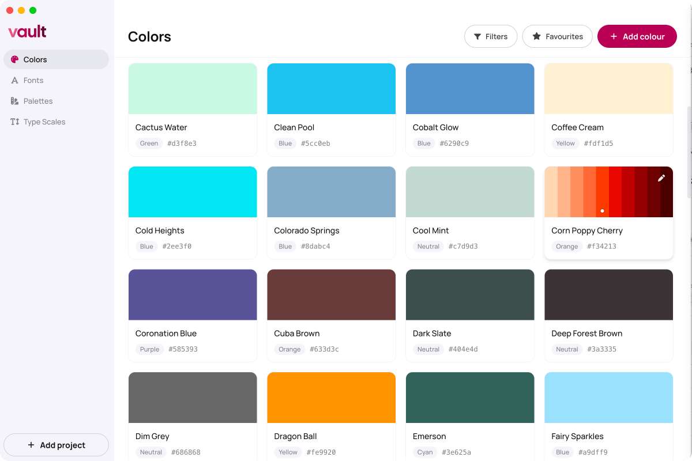
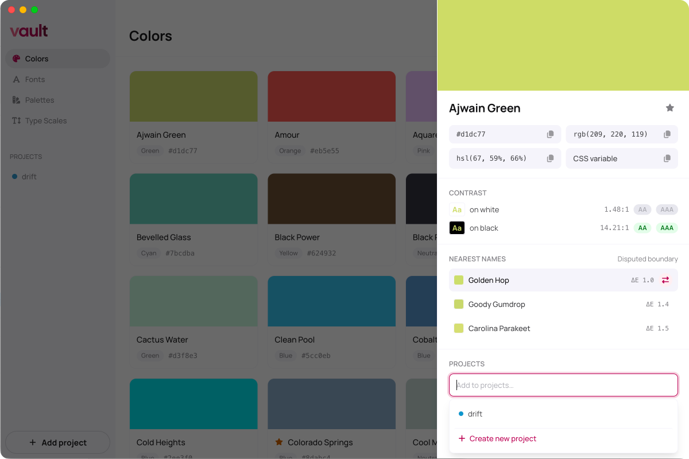
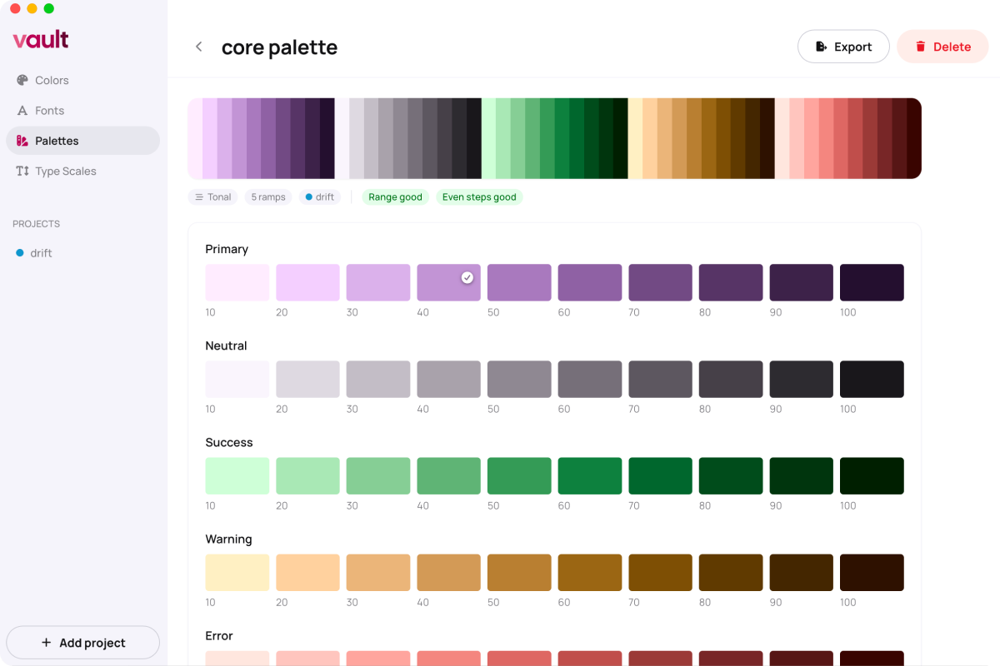
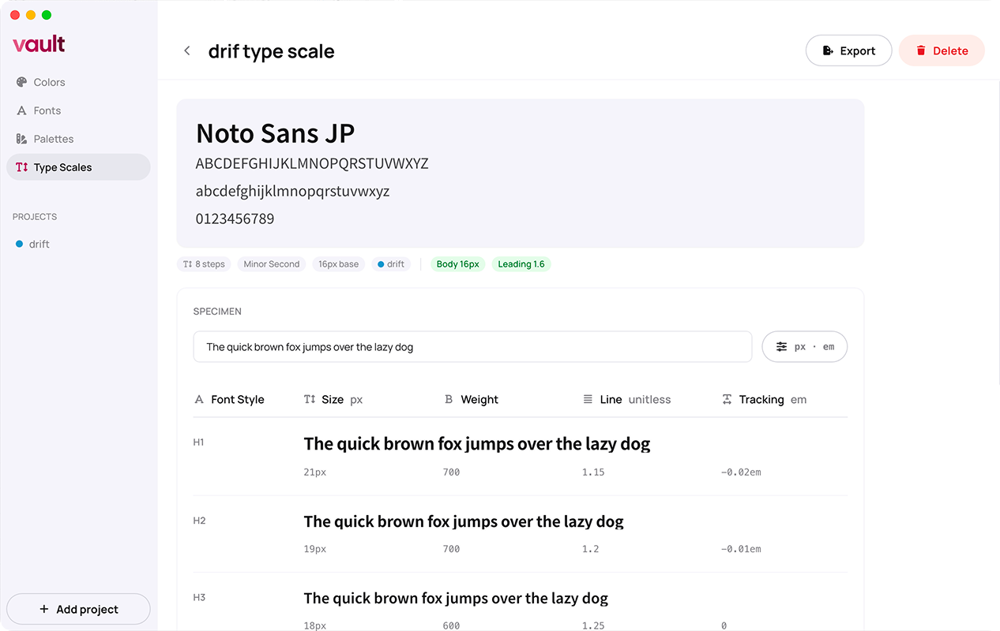
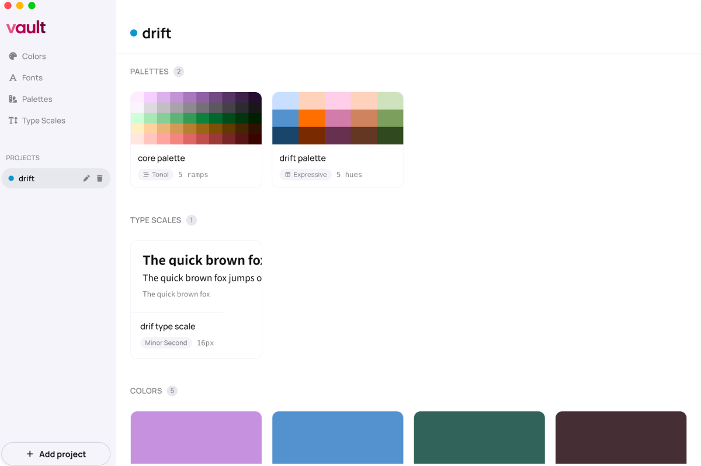

# Vault

An offline, single-user desktop app for capturing and shaping design tokens: colours, fonts,
palettes, and type scales. Built with Electron, React, and SQLite.



## Design

- **One accent, for actions.** Ruby marks what you can act on: primary buttons, the active
  filter and nav item, focus rings. Everything else is grey, so the colours you collect stay
  the brightest thing on screen. The favourite star is gold, because it marks state rather than
  an action.
- **Light mode only, on purpose.** One pale theme keeps the design work on one surface. The
  two-tier token layer means a dark theme is mostly an override of the semantic aliases:
  deferred, not ruled out.
- **Tokens from [haus](https://github.com/hipuku/haus), components of its own.** Vault reads
  every role from `haus-tokens` and points the brand at its ruby ramp. Its 49 components sit in
  three tiers (15 atoms, 16 molecules, 18 organisms), and imports only run downward. The atoms
  and molecules were audited against WCAG and the ARIA patterns they claim; all seven defects
  found are fixed.
- **Manrope, bundled.** A 200 to 800 weight axis, shipped with the app because a local-first app
  cannot depend on a font CDN. Cal Sans was tried first and reverted: one weight flattened the
  hierarchy the type scale tool exists to show.
- **The system is enforced.** Stylelint fails any colour, type, spacing, radius or z-index set as
  a raw value instead of a token, with the few deliberate exceptions listed and explained in
  `stylelint.config.mjs`.

[`DESIGN.md`](./DESIGN.md) has the reasoning and the alternatives behind each of these.

|                                                                             |                                                                                          |
| --------------------------------------------------------------------------- | ---------------------------------------------------------------------------------------- |
|  |                        |
|             |  |

## Features

- **Colours.** Capture hexes, auto-named, with perceptual ramps and contrast checks.
- **Fonts.** Add from Google Fonts, your installed fonts (Font Book), or a file; preview at any
  size; grab the file back out.
- **Palettes.** Generate tonal systems or expressive multi-hue sets from your library, then
  export to CSS, SCSS, Design Tokens or Tailwind.
- **Type scales.** Product or Web/Markup presets on a ratio, live unit conversion (px, rem, pt
  and the rest), per-step tuning, and the same four export formats.
- **Projects.** Tag any asset, then view everything for a project in one place.
- **Command palette.** `⌘K` to jump to any section or project, or start a new asset, without
  leaving the keyboard.

Everything is local. There are no accounts and no cloud. Your library lives in
`~/Library/Application Support/Vault/`, as a SQLite database plus copied font files, and never
leaves your machine. The one exception is Google Fonts: adding or previewing a font from Google
fetches it. [`DESIGN.md`](./DESIGN.md) lists every request.

## Install

Vault is a direct download for macOS. It is not on the App Store and needs no account.

1. Download the `.dmg` for your Mac from [Releases](../../releases). `Vault-<version>-arm64.dmg`
   is for Apple Silicon, `Vault-<version>.dmg` for Intel.
2. Open it and drag **Vault** into Applications.
3. **First launch only.** The build is unsigned, so macOS quarantines it on download. Clear the
   quarantine once:

   ```bash
   xattr -cr /Applications/Vault.app
   ```

   Then open Vault normally. Right-click, then Open, also works on some macOS versions.

## Develop

Node 22 or newer, as `.nvmrc` and the `engines` field both say. Electron 44 and the SQLite
driver each require it.

```bash
nvm use
npm install      # postinstall fetches the Electron binary
npm run dev      # launch the app with HMR
```

## Scripts

| Command             | Does                                                                   |
| ------------------- | ---------------------------------------------------------------------- |
| `npm run dev`       | Run the app (electron-vite, HMR)                                       |
| `npm run typecheck` | `tsc --noEmit` across main and renderer                                |
| `npm run test`      | Vitest (watch): the pure `lib/` logic in node, the components in jsdom |
| `npm run test:run`  | Vitest once (CI)                                                       |
| `npm run lint`      | ESLint (typescript-eslint + react-hooks)                               |
| `npm run format`    | Prettier write                                                         |
| `npm run build`     | Production build                                                       |
| `npm run dist:mac`  | Unsigned `.dmg` (arm64 and Intel)                                      |

## More

- [`FEATURE.md`](./FEATURE.md) is a visual tour of every feature.
- [`DESIGN.md`](./DESIGN.md) covers the architecture, the design system, and the decisions
  behind the build.

## Stack

Electron · React · TypeScript · CSS Modules · better-sqlite3 · electron-vite · chroma-js ·
culori · `haus-tokens` · `haus-colour-utils` · `haus-colour-names`
